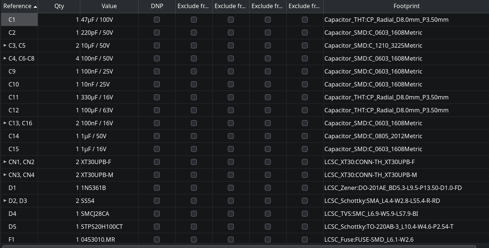
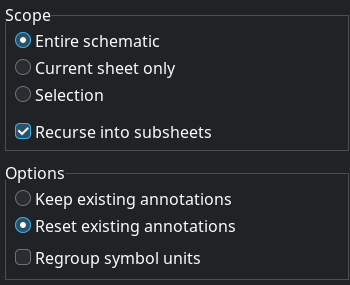
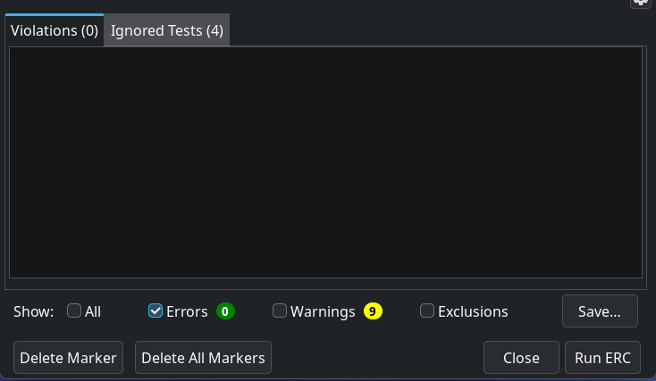

# 1. Schematics Operation
## 1.1 bulk edit symbol fields
> symbol management table
- reference
- value
- footprint

## 1.2 Annotate Schematics
> reset reference

## 1.3 Electrical Rules Checker

## 1.4 