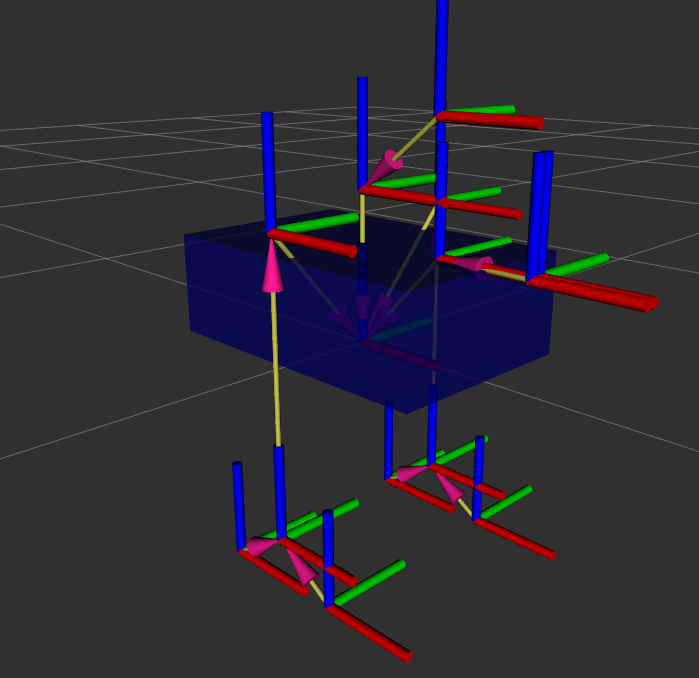
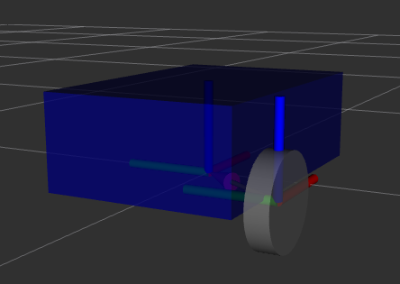

# 1. TF - TransForm
## 1.1 Purpose
> Keep a structured tree for all the joints/frames over time

> We want to know:
> - How frames are placed and moved relative to one another
> - We should describe the pose and location
## 1.2 TF
An TF description
```
translation:
	x: 0.2
	y: 0.0
	z: 0.3
pose:
	x: 0.0
	y: 0.0
	z: 0.0
	w: 1.0
```
why using quaternion to describe pose?
- Euler Angle
- Rotation Matrix
- Quaternion

# 2. URDF - Unified Robot Description Format
## 2.1 URDF file
>  Description of all the elements in a robot
>  **Used to generate TFs**
>  XML format
```xml

```
## 2.2 RViz
> Visualize the Robot on RViz
## 2.3 Link
> 一个刚性部件，内部相对位置固定，不会彼此运动
```xml
<link name="base_link">
    <visual>
        <geometry>
            <box size="0.6 0.4 0.2" />
        </geometry>
        <origin xyz="0 0 0.1" rpy="0 0 0" />
        <material name="blue" />
    </visual>
</link>
```
- 定义一个名为 `base_link` 的刚性部件
- 用蓝色长方体显示它

## 2.4 joint
> 两个link之间的连接
```xml
<joint name="base_second_joint" type="fixed">
	<parent link="base_link" />
	<child link="second_link" />
	<origin xyz="0 0 0.2" rpy="0 0 0" />
</joint>
```
joint type
- fixed
- revolute
- continuous
- prismatic
## 2.5 Policy
- link的origin在底部
- link的visual在中心
```xml
<?xml version="1.0"?>

<robot name="my_robot">

<!--material-->

<material name="blue">

<color rgba="0 0 0.5 1" />

</material>

  

<material name="grey">

<color rgba="0.5 0.5 0.5 1" />

</material>

  

<!--links-->

<link name="base_link">

<visual>

<geometry>

<box size="0.6 0.4 0.2" />

</geometry>

<origin xyz="0 0 0.1" rpy="0 0 0" />

<material name="blue" />

</visual>

</link>

  

<link name="right_wheel_link">

<visual>

<geometry>

<cylinder radius="0.1" length="0.05" />

</geometry>

<origin xyz="0 0 0" rpy="1.57 0 0" />

<material name="grey" />

</visual>

</link>

  

<!--joints-->

<joint name="base_right_wheel_joint" type="continuous">

<parent link="base_link" />

<child link="right_wheel_link" />

<origin xyz="-0.15 -0.225 0" rpy="0 0 0" />

<axis xyz="0 1 0" />

</joint>

  

</robot>
```


## 2.7 footprint
> 为了描述平面运动，给车选一个位于地面上的参考点
```xml
<link name="base_footprint" />

<joint name="base_joint" type="fixed">
    <parent link="base_footprint" />
    <child link="base_link" />
    <origin xyz="0 0 0.1" rpy="0 0 0" />
</joint>
```

# 3. Broadcast TFs

